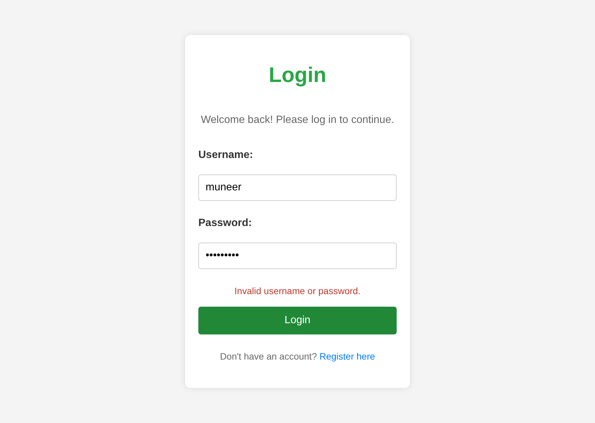
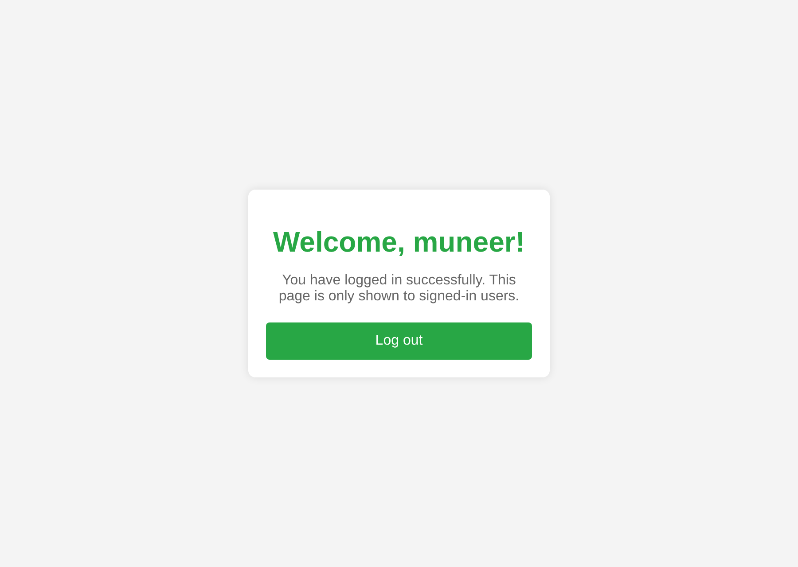

# Login and Registration with Node.js

A small full-stack app where people can create an account, log in and reach a dashboard that only signed-in users can see. The front end is plain HTML, CSS and JavaScript; the back end is **Node.js** with **Express**, passwords are hashed with **bcrypt**, and accounts are kept in a JSON file.


[](https://github.com/MuneerMiller/login-json/actions/workflows/tests.yml)

| Login with a clear error | Protected dashboard |
| --- | --- |
|  |  |

## Features

- **Register** with a username and password. Usernames must be unique (ignoring case) and passwords need at least 8 characters.
- **Log in** to get a session cookie, then land on a dashboard that greets you by name.
- **Protected dashboard.** `/dashboard` sends anyone who isn't logged in back to the login page, and the page isn't served as a public file.
- **Log out** ends the session on the server, not just in the browser.
- **Clear feedback.** Errors and successes show inside the form instead of pop-up alerts.

## How it keeps accounts safe

This is a learning project, but it follows the basics properly:

- **Passwords are hashed with bcrypt** (10 salt rounds) and never stored or logged in plain text.
- **Only the username and hash are saved.** Any extra fields sent with a request are ignored, so nobody can sneak in something like `"isAdmin": true`.
- **Login errors don't reveal which usernames exist.** A wrong password and an unknown user get the same message.
- **Sessions use a random 256-bit token** in an `HttpOnly`, `SameSite=Strict` cookie, so page scripts can't read it and other sites can't send it. Sessions expire after an hour.
- **Sign-ups are written one at a time**, so two people registering together can't overwrite each other.
- **`data.json` is in `.gitignore`**, so account data never ends up in the repository.

## Getting started

You need [Node.js](https://nodejs.org/) 20 or newer.

```bash
git clone https://github.com/MuneerMiller/login-json.git
```

```bash
cd login-json
```

```bash
npm install
```

```bash
npm start
```

Then open <http://localhost:3000>. The first registration creates `data.json` next to `server.js`.

To use a different port, set `PORT`, for example `PORT=8080 npm start`.

## Running the tests

```bash
npm test
```

The tests use Node's built-in test runner. They start the server on a free port with a temporary data file, and cover registration, duplicate usernames, wrong passwords, the protected dashboard and logging out. GitHub Actions runs them on Node.js 20 and 22 for every push and pull request.

## API

| Method | Path | What it does |
| --- | --- | --- |
| `POST` | `/register` | Creates an account from `{ "username", "password" }`. Returns `201`, or `400` / `409` with a message |
| `POST` | `/login` | Checks the password and sets the session cookie. Returns `200` or `401` |
| `GET` | `/dashboard` | The dashboard page, or a redirect to `/` when logged out |
| `GET` | `/api/me` | The logged-in user's name, or `401` |
| `POST` | `/logout` | Ends the session |

## Project structure

```
login-json/
├── public/
│   ├── index.html      # Registration and login forms
│   ├── script.js       # Form handling and messages
│   └── styles.css      # Styling
├── views/
│   └── dashboard.html  # Only served to logged-in users
├── test/
│   └── server.test.js  # API tests
├── docs/               # Screenshots for this README
├── server.js           # Express server, sessions and validation
└── package.json
```

## What I'd add next

- Keep sessions in a store such as Redis, so they survive a server restart.
- Move accounts from a JSON file to a database such as SQLite or PostgreSQL.
- Rate-limit login attempts to slow down password guessing.

## Licence

Copyright © 2026 Mogamat Muneer Miller. All rights reserved. The code is public so you can read it and learn from it, but it is not open source. See [LICENSE](LICENSE).

## Contact

Built by **[Muneer Miller](https://github.com/MuneerMiller)** · [muneermiller.github.io](https://muneermiller.github.io/)
